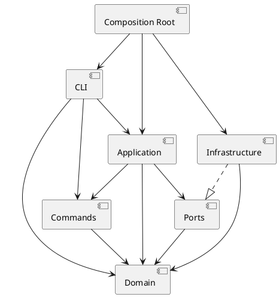

# Lab1：SVG 编辑器（CLI）

## 文档状态

步骤一至七已实现并发布到远程 `main`，代码基线为 `8eff0ff`。步骤八已完成最终报告、一致性自查、531 个测试、构建产物回放及浏览器核验；本轮文档和证据纳入本地提交，尚未创建 `final` 标签或推送本轮提交。当前完整结果见 [S8.md](./S8.md)，下面按时间保留 S1—S7 的过程，不将历史阶段的“尚未实现/未推送”表述当作当前状态。

2026-10-30 补充修正了 `front/back` 的视觉顺序，并提前实现了应用层的同步查询/文档操作历史策略及画布尺寸失败原子性。规范见 [验收规格的语义澄清](./acceptance-spec.md#语义澄清2026-10-30)，修订验证见 [S4.md](./S4.md)。该次修订只覆盖内存操作，实际 SVG 读写在下述 S5 中完成。

同日继续完成移动异常、数值溢出和公开层级接口保护：几何操作先校验整棵子树的计算结果，再统一提交；已挂载节点的结构修改统一经过 Document。新增测试与 200 个测试通过的结果记录在 [S4.md](./S4.md)。

同日完成 S5：增加 DocumentSession、同步文件和 SVG 端口、NodeFileSystem、SvgReader/SvgWriter；定向运行 46 个测试通过，并通过类型检查和构建。本地渲染确认流程图和置顶/置底效果，并通过独立 HTTP 入口完成 Edge 自动验收。CLI 业务解析及文本输出留给 S6。详细支持范围、路径策略和验证记录见 [S5.md](./S5.md)。

用户随后要求完整测试，已全量运行 10 个测试文件、235 个测试并全部通过，类型检查、构建和差异检查通过；无须修改实现代码。浏览器核验结果见 S5 文末。

同日按用户要求增加 `npm run preview:s5`：通过仅监听 127.0.0.1 的固定路由服务生成六组独立测试样例。Edge 中加载、SVG DOM、保存读回、中文与继承样式、ID 补全及 front/back 截图像素检查均通过；控制台无警告或错误。全量 235 个测试、含脚本的类型检查和构建再次通过。该入口是开发验收辅助工具，未改动 CLI 或生产业务逻辑，未提交代码。

上述 S5 工作随后经用户授权统一提交并推送，提交为 `0888fd2`。同日完成 S6：解析器、参数检查、19 条命令注册、tree/show/help、单行错误及撤销重做摘要，main.ts 接入同一个 DocumentSession。含用户要求收紧 init 参数及支持行末注释后的回归，共新增 93 个测试，全量 14 个文件、328 个测试、类型检查和构建通过。实际 CLI 生成的五组 SVG 经独立 HTTP 入口通过 Edge 加载、DOM、中文和截图像素检查，后续修订未改变这些样例使用的语法；详见 [S6.md](./S6.md)。用户随后授权将相关代码、测试和文档合并为一笔本地提交，本次不推送或创建 tag。

同日完成 S7：在 328 个基线测试上新增 139 个用例，完整复核命令、错误、历史、树形输出及典型会话。三个先失败的用例复现 SVG 文本中回车字符保存读回失真，修复后通过；提取几何命令快照流程、分组注册方法并将类移到同名文件。最终 18 个文件、467 个测试、类型检查、构建和 lint 通过，57 个源文件的架构检查无违规。过程、矩阵和边界见 [S7.md](./S7.md)。步骤七与下述非负值修复的代码、测试和文档按用户授权统一纳入本次本地提交；未推送或创建 tag，S8 发布尚未执行。

2026-10-31 按用户要求只修复评审第一项：领域层拒绝负的画布/矩形宽高、圆/椭圆半径及描边宽度，保留零值和负坐标。新增 64 个回归用例，修复前 57 失败、7 通过，修复后全部通过；当前全量 19 个文件、531 个测试、类型检查、构建和 lint 通过。规则见 [验收规格](./acceptance-spec.md)，过程见 [S7.md](./S7.md) 补充记录。

上述 S7 与非负值修复已统一提交为 `8eff0ff`，随后按用户明确要求推送；其父提交 S6 的 `5bec976` 同时进入远程。2026-10-31 继续完成 S8 的文档与最终验收，修正 README 的个人绝对路径链接和 REPL 职责描述，并把当前截图、DOM 记录、实际命令输出及 SVG 参考文件纳入仓库交付范围。最终发布状态见 [S8.md](./S8.md)。

原始实验文档：[`phase_cli_1.md`](./phase_cli_1.md)。

配套规格文档：

- [`acceptance-spec.md`](./acceptance-spec.md)：可观察行为、命令、错误和端到端验收条件；
- [`test-draft.md`](./test-draft.md)：按领域层、Command 层、CLI 层和 IO 层组织的测试草稿。
- [`acceptance-results.md`](./acceptance-results.md)：阶段一的历史验收记录；当前结果以各步骤记录为准。
- [`S1.md`](./S1.md)：步骤一新增代码、功能、测试和结果。
- [`S2.md`](./S2.md)：步骤二新增代码、功能、测试和结果。
- [`S3.md`](./S3.md)：步骤三新增代码、功能、测试和结果。
- [`S4.md`](./S4.md)：步骤四新增代码、功能、测试和结果。
- [`S5.md`](./S5.md)：步骤五 SVG 读写、文档会话、路径与历史策略、定向检查和浏览器验收边界。
- [`S6.md`](./S6.md)：步骤六 CLI 语法、全命令接线、Visitor 展示、93 个新增测试和实际 CLI 输出的浏览器验收。
- [`S7.md`](./S7.md)：步骤七完整测试矩阵、SVG 文本回归修复、重构、139 个初始新增测试、64 个非负值回归测试和架构检查。
- [`S8.md`](./S8.md)：最终验收矩阵、架构一致性、可复现会话、浏览器证据、提交历史、发布状态与保留风险。

## 架构方案

### 1. 模块划分

| 模块 | 职责 |
|---|---|
| `src/domain` | 保存 SVG 文档、画布、图形和容器的状态；提供创建、查找、移动、缩放、属性设置、层级维护等领域行为 |
| `src/commands` | 定义 `Command` 接口和具体命令；保存命令参数及撤销所需状态；调用领域对象完成操作 |
| `src/application` | 提供 `CommandExecutor`、命令历史和 `DocumentSession`；管理当前文档、读入路径及编辑/查询/文档操作的历史策略 |
| `src/application/ports` | 定义同步 FileSystem、SvgReaderPort、SvgWriterPort，隔离文件与编解码实现 |
| `src/infrastructure` | 实现同步 UTF-8 文件读写、同目录临时文件替换、SVG 解析与序列化 |
| `src/cli` | 实现参数解析、引号和注释处理、命令注册、帮助、错误及 tree/show 输出 |
| `src/main.ts` | 装配各模块和依赖，以 Node readline 实现 `svg>` REPL、逐行执行与 EOF 退出 |
| `tests` | 保存领域、命令、应用和 CLI 集成测试 |
| `scripts` | 开发期的架构检查及 S5/S6 固定路由预览工具，不进入生产领域模型 |
| `doc` | 保存架构、过程、验收与质量说明；assets 保存精简证据，examples 保存可回放会话和实际输出 |

### 2. 设计模式的选择

#### Command

- `Command`：命令接口；
- `ConcreteCommand`：步骤三的 `CreateCommand`、`DeleteCommand`、`MoveCommand`、`ScaleCommand`、`SetCommand`；步骤四的 `GroupCommand`、`UngroupCommand`、`AddToCommand`、`FrontCommand`、`BackCommand`；
- `Receiver`：`Document`、`Shape` 和 `Group`；
- `Invoker`：`CommandExecutor`；
- `Client`：CLI 解析和装配代码。

具体命令负责保存参数、调用接收者和保存撤销所需的状态，图形业务规则由领域对象负责。

S7 提取 GeometryCommand 作为移动/缩放的共同基类，统一状态检查、子树快照和撤销；MoveCommand/ScaleCommand 各自实现 transform 并调用 Shape 的对应行为。这是命令内部的模板方法复用，不改变 Command 的公开接口和历史规则。

#### Composite 语义

`Shape` 作为统一抽象，叶子图形和 `Group` 都支持 `move`、`scale`、`set`、`delete`。`move/scale` 由基类遍历整个子树，各具体图形通过 `prepareMove/prepareScale` 计算并校验自己的结果；全部准备完成后才提交。Group 本身没有几何字段，保留有序子节点并参与统一遍历。几何规则仍由具体图形负责，没有增加按图形名称分派。

新增图形实现准备方法时，准备阶段必须无状态修改，返回的提交函数只写入已校验的值。这一约束保证后部节点失败时，前部节点也不发生部分更新。

#### Visitor 展示

S6 增加领域层的 `ShapeVisitor` 接口和各图形的 `accept`，CLI 的 ShapePresenter 实现几何、父级和文字展示。tree/show 通过对象多态取得图形特有信息，不新增按图形类型名的分支。接口只引用领域类型，domain 不依赖 CLI。增加新内置图形时需要相应增加访问方法；未来插件的展示协议另行设计。

### 3. 依赖方向

```text
main.ts（Composition Root）
├── cli ───────────────> application ─────> commands ─────> domain
├── application ───────> ports
└── infrastructure ────implements─────────> ports
```

规则：

- `domain` 不依赖 CLI、Node 文件系统或 XML 库；
- `commands` 依赖领域抽象，不直接解析命令行文本；
- `application` 可依赖 commands、domain 和自身 ports；ports 只依赖 domain 或其他 ports；
- `cli` 不直接修改图形内部字段；
- `cli` 作为命令接线层可使用 application、commands 和 domain 的公共接口；
- `infrastructure` 通过 `ports` 提供外部实现；
- `infrastructure` 可使用 domain、Node 和 XML 库，不依赖 CLI 或具体应用服务；
- `main.ts` 负责依赖注入和对象装配；
- 按名字分派只保留在 `CommandRegistry` 和 `ShapeFactory` 两处。

历史策略按实际操作划分：编辑通过 `CommandExecutor.execute`，查询通过 `executeQuery`，同步文档操作通过 `executeDocument`。仅操作成功后才更新历史；操作自身负责文档状态的失败原子性。无参数 `canvas` 走查询入口，带参数修改走文档入口，不能仅按命令名统一处理。

S5 的 DocumentSession 通过端口使用文件和编解码服务，不依赖其实际实现。SvgReader 经 ShapeFactory 创建对象，统一通过 Document 挂载；SvgWriter 通过公共 attributes/children 递归写出，text 字段作为子文本，不新增按图形名称的分派。S6 已由 SvgCli/CommandRegistry 格式化结构化结果和 warning，main.ts 装配真实端口实现、一个会话及 REPL。

CLI 的 create 参数、set 数值校验和 help 使用 ShapeFactory 的同一份参数元数据；业务合法性仍由领域层校验。撤销重做摘要按真实 Command 对象保存在 WeakMap 中，没有额外历史栈。两处允许的名字分派仍为 CommandRegistry 和 ShapeFactory，作为后续插件化与重构评审的集中待处理点。

结构写入边界：公开 Group 添加、插入、删除方法仅用于脱离文档的树；已挂载对象统一通过 Document 修改。父级、归属和子列表采用私有字段，公开 getter 只提供只读访问或列表副本。`domain/internal/treeMutation.ts` 的 Symbol 入口只供 Document、Group、Shape 协作，不从 `domain/index.ts` 导出；commands 及其他层不得导入它。GroupCommand 和 UngroupCommand 也通过 Document 挂载对象，不再传入 Document 引用绕过校验。

对应的 PlantUML 草图：



### 4. 变化点假设

| 变化点 | 当前预留 |
|---|---|
| 新增内置图形类型 | 新图形类、ShapeFactory 构造/参数元数据及 Visitor 方法；不改通用参数解析和命令执行器。插件展示不在本阶段预留 |
| 新增 CLI 命令 | 通过 `CommandRegistry` 注册具体命令 |
| SVG 解析库或文件存储变化 | 通过 `ports` 隔离基础设施 |
| undo/redo 策略变化 | 集中在 `CommandExecutor` 和 `CommandHistory` |
| `box` 插件类型 | 当前步骤只记录扩展边界，不实现 `box` |

### 5. 过程记录

ai 制定计划时只关注了功能划分和实现，却没关注文档中一些具体的规则，比如不同命令的具体报错

ai完成一部分任务后只回复一个笼统的结果，要求其每完成一步都生成一个对应文档详细说明结果

原本会话上下文过长，思考链中多次出现修改代码错误的描述，故新开一个会话进行测试，发现下述两个问题后新增相关测试样例并进行修复

2026-10-30 测试评审发现两处验收口径问题：旧 front/back 测试把列表开头误当成视觉最上层；派生验收规格把无参数 canvas 查询也列入历史禁用操作。现按 SVG 绘制顺序和原文第 4.3 节的具体限定统一口径，并记录文档操作成功时清空旧历史这一项目补充决定。新增回归测试还复现了画布高度非法时宽度已经改变的问题，改为校验两个尺寸后再写入。

2026-10-30 后续回归补测在旧几何实现上出现 50 个失败，在收紧层级入口前出现 9 个失败。几何计算改为整个子树准备完成后再提交，既修复非法 dy 导致 x 已改变，也拒绝有限输入产生的非有限结果。层级修复移除了公开父级/归属 setter 和 Group 的 Document 参数，补齐脱离文档树的跨分支 ID 检查。21 条混合命令的完整撤销重做验证了这些调整与现有 Command 机制一致。

实现过程中，agent 提示部分规则未在实验要求注明，需自行决定

init 最初允许单参数并采用默认高度，后明确要求收紧为只接受零或两个参数

原本未支持行末注释，在分词时识别引号外独立的 #，保留颜色及文字/路径内的 #，并同步 help。


### 6. 一致性自查

实现完成后检查：

1. 实际目录是否与模块划分一致；
2. 是否存在 `domain → cli`、`domain → infrastructure` 等违规依赖；
3. 是否仍然只有命令注册和图形工厂使用名字分派；
4. 目录或依赖发生变化时，是否补充了修订记录。

S6 自查：新增代码位于既定 cli/domain/scripts/tests 目录；抽查 domain 无 CLI、Node 或 XML 库依赖，CLI 不导入内部 treeMutation，也不直接写图形字段。新的图形展示采用 Visitor，类型名构造分派仍集中在工厂，命令名分派集中在注册表。

S7 全量自查：实际源目录与原模块方案一致；GeometryCommand 和同名错误类均归入已有模块，旧入口保留重导出。57 个源文件经 AST 检查和人工复核，无违规依赖；领域层不依赖 CLI 或基础设施。类与文件同名，内部结构写入入口未向外层开放，名字分派仍集中于两处。属性白名单 switch 与容器资格校验保留，理由见 S7 的重构与依赖检查。PlantUML 已补齐实际存在的 CLI→commands/domain、application→domain、ports/infrastructure→domain 依赖。

S8 核对的目录数量为 domain 15、commands 19、application 9（含 ports）、infrastructure 6、cli 7，加 main.ts 共 57 个生产源文件；开发期 scripts 为 6 个文件。目录与方案一致，REPL 职责说明和开发目录遗漏已修订。抽查 DocumentSession 的端口依赖、命令到领域对象的调用、SvgReader 的工厂入口以及 ShapePresenter 的 Visitor 接口，与依赖图一致。原文允许的命令注册和图形工厂集中分派仍标为后续插件化待重构点，未声称已完成通用插件机制。

### 7. 质量保证手段

- 先写领域对象和命令的失败测试；
- 测试 `execute`、`undo`、`redo` 以及 redo 栈清空规则；
- 测试 Group 的递归操作和父子关系；
- 测试 SVG 读写、缺失 ID 自动补全和错误信息；
- 使用真实 CLI 集成测试，逐条回放实验第 6 节的完整 transcript，核对命令反馈、预期错误及实际 SVG 文件；
- 运行测试、TypeScript 构建和代码检查；
- 将保存出的 SVG 在浏览器中打开，检查渲染结果。

完整会话验收以[实验文档](./phase_cli_1.md)第 6 节“典型会话（完整 transcript）”为依据。[CLI 集成测试](../tests/cli-repl.test.ts)启动真实命令行子进程，在独立临时目录准备原文给出的 `other.svg`，按原顺序输入全部 19 条命令，检查标准输出、标准错误、退出码及保存后重新读入的模型。该测试已通过，构建产物也已按同一段原文逐条回放，核对结果如下：

| 检查内容 | 与原文预期的核对结果 |
|---|---|
| 编辑与撤销重做 | 圆经过移动、undo、redo 后位于 `(130,100)`；撤销文字修改后恢复 `My Diagram`；删除 `box` 后撤销，恢复到 `markers` 容器 |
| 保存 SVG | `demo.svg` 为 800×600、5 个元素，位置、文字和父子关系符合会话结束编辑时的状态 |
| 读取外部 SVG | `other.svg` 读入后为 400×300、7 个元素；缺失 ID 的矩形补为 `rect1` 并输出警告，结构树符合原文 |
| 预期错误 | 仅出现原文规定的两条错误：分组目标同时包含容器及其后代、保存后执行 undo；错误文本与原文一致 |
| 完整命令反馈与退出 | 除树形输出的列对齐空格外，反馈与原文一致；输入结束后正常退出，退出码为 0 |

可单独运行该完整会话的集成测试：

```text
node node_modules/vitest/vitest.mjs run tests/cli-repl.test.ts -t "runs the original typical session"
```

S8 重跑全部 19 个文件、531 个测试，类型检查、构建、lint 均通过；检查器自身保留 27 个正反例测试。已有真实 REPL/文件测试与本次 `dist/main.js` 回放共同验证源程序和构建产物；负尺寸错误及保存后的历史禁用均符合预期。S8 的浏览器核验确认五组图片加载、中文和重叠颜色正确，保存读回前后的 SVG DOM 完全一致。具体证据见 [S8.md](./S8.md)。
