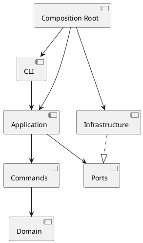

# Lab1：SVG 编辑器（CLI）

## 文档状态

当前已完成步骤一至六：项目脚手架、领域模型、编辑命令与历史、层级和 z-order、SVG 读写与文档会话，以及真实 CLI 解析、全命令接线和文本输出。实现过程中如果目录、依赖方向或设计模式发生变化，应在本文档的过程记录和一致性自查中更新。各步骤的具体记录见下方 `S1.md` 至 `S6.md`。

2026-10-30 补充修正了 `front/back` 的视觉顺序，并提前实现了应用层的同步查询/文档操作历史策略及画布尺寸失败原子性。规范见 [验收规格的语义澄清](./acceptance-spec.md#语义澄清2026-10-30)，修订验证见 [S4.md](./S4.md)。该次修订只覆盖内存操作，实际 SVG 读写在下述 S5 中完成。

同日继续完成移动异常、数值溢出和公开层级接口保护：几何操作先校验整棵子树的计算结果，再统一提交；已挂载节点的结构修改统一经过 Document。新增测试与 200 个测试通过的结果记录在 [S4.md](./S4.md)。

同日完成 S5：增加 DocumentSession、同步文件和 SVG 端口、NodeFileSystem、SvgReader/SvgWriter；定向运行 46 个测试通过，并通过类型检查和构建。本地渲染确认流程图和置顶/置底效果。首次浏览器访问策略阻止本地 file 预览；后续已通过独立 HTTP 入口完成 Edge 自动验收。CLI 业务解析及文本输出留给 S6。详细支持范围、路径策略和验证记录见 [S5.md](./S5.md)。

用户随后要求完整测试，已全量运行 10 个测试文件、235 个测试并全部通过，类型检查、构建和差异检查通过；无须修改实现代码。浏览器工具的 file 协议限制仍保留；后续受支持 HTTP 入口的通过记录与该限制分别记录在 S5 文末。

同日按用户要求增加 `npm run preview:s5`：通过仅监听 127.0.0.1 的固定路由服务生成六组独立测试样例。Edge 中加载、SVG DOM、保存读回、中文与继承样式、ID 补全及 front/back 截图像素检查均通过；控制台无警告或错误。全量 235 个测试、含脚本的类型检查和构建再次通过。该入口是开发验收辅助工具，未改动 CLI 或生产业务逻辑，未提交代码。

上述 S5 工作随后经用户授权统一提交并推送，提交为 `0888fd2`。同日完成 S6：解析器、参数检查、19 条命令注册、tree/show/help、单行错误及撤销重做摘要，main.ts 接入同一个 DocumentSession。含用户要求收紧 init 参数及支持行末注释后的回归，共新增 93 个测试，全量 14 个文件、328 个测试、类型检查和构建通过。实际 CLI 生成的五组 SVG 经独立 HTTP 入口通过 Edge 加载、DOM、中文和截图像素检查，后续修订未改变这些样例使用的语法；详见 [S6.md](./S6.md)。用户随后授权将相关代码、测试和文档合并为一笔本地提交，本次不推送或创建 tag。

原始实验文档：[`phase_cli_1.md`](<C:/Users/Lenovo/Desktop/高级软件开发技术/lab1/doc/phase_cli_1.md>)。

配套规格文档：

- [`acceptance-spec.md`](./acceptance-spec.md)：可观察行为、命令、错误和端到端验收条件；
- [`test-draft.md`](./test-draft.md)：按领域层、Command 层、CLI 层和 IO 层组织的测试草稿。
- [`acceptance-results.md`](./acceptance-results.md)：阶段一的历史验收记录；当前结果以各步骤记录为准。
- [`S1.md`](./S1.md)：步骤一新增代码、功能、测试和结果。
- [`S2.md`](./S2.md)：步骤二新增代码、功能、测试和结果。
- [`S3.md`](./S3.md)：步骤三新增代码、功能、测试和结果。
- [`S4.md`](./S4.md)：步骤四新增代码、功能、测试和结果。
- [`S5.md`](./S5.md)：步骤五 SVG 读写、文档会话、路径与历史策略、定向检查和浏览器验收边界。
- [`S6.md`](./S6.md)：步骤六 CLI 语法、全命令接线、Visitor 展示、93 个新增测试和实际 CLI 输出的浏览器验收。

## 架构方案

### 1. 模块划分

| 模块 | 职责 |
|---|---|
| `src/domain` | 保存 SVG 文档、画布、图形和容器的状态；提供创建、查找、移动、缩放、属性设置、层级维护等领域行为 |
| `src/commands` | 定义 `Command` 接口和具体命令；保存命令参数及撤销所需状态；调用领域对象完成操作 |
| `src/application` | 提供 `CommandExecutor`、命令历史和 `DocumentSession`；管理当前文档、读入路径及编辑/查询/文档操作的历史策略 |
| `src/application/ports` | 定义同步 FileSystem、SvgReaderPort、SvgWriterPort，隔离文件与编解码实现 |
| `src/infrastructure` | 实现同步 UTF-8 文件读写、同目录临时文件替换、SVG 解析与序列化 |
| `src/cli` | 实现 `svg>` REPL、参数解析、引号和注释处理、命令注册、帮助和错误输出 |
| `src/main.ts` | 装配各模块和依赖，启动 CLI |
| `tests` | 保存领域、命令、应用和 CLI 集成测试 |
| `doc` | 保存架构方案、过程记录、一致性自查和质量保证说明 |

### 2. 设计模式的选择

#### Command

- `Command`：命令接口；
- `ConcreteCommand`：步骤三的 `CreateCommand`、`DeleteCommand`、`MoveCommand`、`ScaleCommand`、`SetCommand`；步骤四的 `GroupCommand`、`UngroupCommand`、`AddToCommand`、`FrontCommand`、`BackCommand`；
- `Receiver`：`Document`、`Shape` 和 `Group`；
- `Invoker`：`CommandExecutor`；
- `Client`：CLI 解析和装配代码。

具体命令负责保存参数、调用接收者和保存撤销所需的状态，图形业务规则由领域对象负责。

#### Composite 语义

`Shape` 作为统一抽象，叶子图形和 `Group` 都支持 `move`、`scale`、`set`、`delete`。`move/scale` 由基类遍历整个子树，各具体图形通过 `prepareMove/prepareScale` 计算并校验自己的结果；全部准备完成后才提交。Group 本身没有几何字段，保留有序子节点并参与统一遍历。几何规则仍由具体图形负责，没有增加按图形名称分派。

新增图形实现准备方法时，准备阶段必须无状态修改，返回的提交函数只写入已校验的值。这一约束保证后部节点失败时，前部节点也不发生部分更新。

#### Visitor 展示

S6 增加领域层的 `ShapeVisitor` 接口和各图形的 `accept`，CLI 的 ShapePresenter 实现几何、父级和文字展示。tree/show 通过对象多态取得图形特有信息，不新增按图形类型名的分支。接口只引用领域类型，domain 不依赖 CLI。增加新内置图形时需要相应增加访问方法；未来插件的展示协议另行设计。

### 3. 依赖方向

```text
main.ts（Composition Root）
├── cli ───────────────> application ─────> commands ─────> domain
├── application ───────> ports
└── infrastructure ────implements─────────> ports
```

规则：

- `domain` 不依赖 CLI、Node 文件系统或 XML 库；
- `commands` 依赖领域抽象，不直接解析命令行文本；
- `cli` 不直接修改图形内部字段；
- `infrastructure` 通过 `ports` 提供外部实现；
- `main.ts` 负责依赖注入和对象装配；
- 按名字分派只保留在 `CommandRegistry` 和 `ShapeFactory` 两处。

历史策略按实际操作划分：编辑通过 `CommandExecutor.execute`，查询通过 `executeQuery`，同步文档操作通过 `executeDocument`。仅操作成功后才更新历史；操作自身负责文档状态的失败原子性。无参数 `canvas` 走查询入口，带参数修改走文档入口，不能仅按命令名统一处理。

S5 的 DocumentSession 通过端口使用文件和编解码服务，不依赖其实际实现。SvgReader 经 ShapeFactory 创建对象，统一通过 Document 挂载；SvgWriter 通过公共 attributes/children 递归写出，text 字段作为子文本，不新增按图形名称的分派。S6 已由 SvgCli/CommandRegistry 格式化结构化结果和 warning，main.ts 装配真实端口实现、一个会话及 REPL。

CLI 的 create 参数、set 数值校验和 help 使用 ShapeFactory 的同一份参数元数据；业务合法性仍由领域层校验。撤销重做摘要按真实 Command 对象保存在 WeakMap 中，没有额外历史栈。两处允许的名字分派仍为 CommandRegistry 和 ShapeFactory，作为后续插件化与重构评审的集中待处理点。

结构写入边界：公开 Group 添加、插入、删除方法仅用于脱离文档的树；已挂载对象统一通过 Document 修改。父级、归属和子列表采用私有字段，公开 getter 只提供只读访问或列表副本。`domain/internal/treeMutation.ts` 的 Symbol 入口只供 Document、Group、Shape 协作，不从 `domain/index.ts` 导出；commands 及其他层不得导入它。GroupCommand 和 UngroupCommand 也通过 Document 挂载对象，不再传入 Document 引用绕过校验。

对应的 PlantUML 草图：



### 4. 变化点假设

| 变化点 | 当前预留 |
|---|---|
| 新增内置图形类型 | 新图形类、ShapeFactory 构造/参数元数据及 Visitor 方法；不改通用参数解析和命令执行器。插件展示不在本阶段预留 |
| 新增 CLI 命令 | 通过 `CommandRegistry` 注册具体命令 |
| SVG 解析库或文件存储变化 | 通过 `ports` 隔离基础设施 |
| undo/redo 策略变化 | 集中在 `CommandExecutor` 和 `CommandHistory` |
| `box` 插件类型 | 当前步骤只记录扩展边界，不实现 `box` |

### 5. 过程记录

实现过程中持续记录：

- AI 生成方案中被发现的问题；
- 领域模型、命令职责和依赖方向的调整；
- 每次重构前后的测试结果；
- 重要决策及其理由。

ai 制定计划时只关注了功能划分和实现，却没关注文档中一些具体的规则，比如不同命令的具体报错

ai完成一部分任务后只回复一个笼统的结果，要求其每完成一步都生成一个对应文档详细说明结果

原本会话上下文过长，思考链中多次出现修改代码错误的描述，故新开一个会话进行测试，发现下述问题后新增相关测试样例并进行修复

2026-10-30 测试评审发现两处验收口径问题：旧 front/back 测试把列表开头误当成视觉最上层；派生验收规格把无参数 canvas 查询也列入历史禁用操作。现按 SVG 绘制顺序和原文第 4.3 节的具体限定统一口径，并记录文档操作成功时清空旧历史这一项目补充决定。新增回归测试还复现了画布高度非法时宽度已经改变的问题，改为校验两个尺寸后再写入。

2026-10-30 后续回归补测在旧几何实现上出现 50 个失败，在收紧层级入口前出现 9 个失败。几何计算改为整个子树准备完成后再提交，既修复非法 dy 导致 x 已改变，也拒绝有限输入产生的非有限结果。层级修复移除了公开父级/归属 setter 和 Group 的 Document 参数，补齐脱离文档树的跨分支 ID 检查。21 条混合命令的完整撤销重做验证了这些调整与现有 Command 机制一致。

实现过程中，agent 提示部分规则未在实验要求注明，需自行决定

init 最初允许单参数并采用默认高度，后明确要求收紧为只接受零或两个参数

原本未支持行末注释，在分词时识别引号外独立的 #，保留颜色及文字/路径内的 #，并同步 help。

### 6. 一致性自查

实现完成后检查：

1. 实际目录是否与模块划分一致；
2. 是否存在 `domain → cli`、`domain → infrastructure` 等违规依赖；
3. 是否仍然只有命令注册和图形工厂使用名字分派；
4. 目录或依赖发生变化时，是否补充了修订记录。

S6 自查：新增代码位于既定 cli/domain/scripts/tests 目录；抽查 domain 无 CLI、Node 或 XML 库依赖，CLI 不导入内部 treeMutation，也不直接写图形字段。新的图形展示采用 Visitor，类型名构造分派仍集中在工厂，命令名分派集中在注册表；接口变更与未来扩展代价已在上文记录。S7 仍需进行整体质量和重构评审。

### 7. 质量保证手段

- 先写领域对象和命令的失败测试；
- 测试 `execute`、`undo`、`redo` 以及 redo 栈清空规则；
- 测试 Group 的递归操作和父子关系；
- 测试 SVG 读写、缺失 ID 自动补全和错误信息；
- 使用 CLI 集成测试回放实验中的典型会话；
- 运行测试、TypeScript 构建和代码检查；
- 将保存出的 SVG 在浏览器中打开，检查渲染结果。

S6 已实际执行全量 328 个测试、类型检查和构建，真实 CLI 输出的五组 Edge 浏览器专项已有独立记录；后者独立于 Vitest 计数。当前没有配置独立 lint 脚本，不将未运行的 lint 记为通过。最终发布、提交历史和 final tag 的检查留给 S8。


