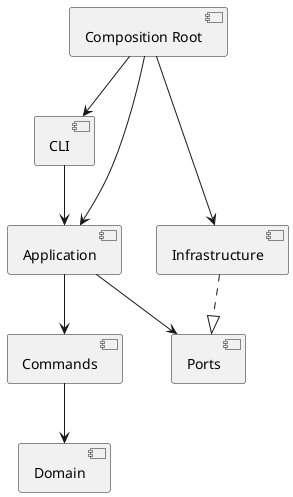

# Lab1 Phase 1：SVG 编辑器（CLI）

## 文档状态

当前版本是项目初始化阶段的架构草案。实现过程中如果目录、依赖方向或设计模式发生变化，应在本文档的过程记录和一致性自查中更新。

原始实验文档：[`phase_cli_1.md`](<C:/Users/Lenovo/Desktop/高级软件开发技术/lab1/doc/phase_cli_1.md>)。

## 架构方案

### 1. 模块划分

| 模块 | 职责 |
|---|---|
| `src/domain` | 保存 SVG 文档、画布、图形和容器的状态；提供创建、查找、移动、缩放、属性设置、层级维护等领域行为 |
| `src/commands` | 定义 `Command` 接口和具体命令；保存命令参数及撤销所需状态；调用领域对象完成操作 |
| `src/application` | 提供 `CommandExecutor` 和命令历史；维护 undo/redo 栈；处理编辑命令、显示命令和文档命令的历史策略 |
| `src/application/ports` | 定义文件系统、SVG 编解码和输出等边界接口 |
| `src/infrastructure` | 实现真实文件读写、SVG 解析与序列化、控制台输出等外部技术细节 |
| `src/cli` | 实现 `svg>` REPL、参数解析、引号和注释处理、命令注册、帮助和错误输出 |
| `src/main.ts` | 装配各模块和依赖，启动 CLI |
| `tests` | 保存领域、命令、应用和 CLI 集成测试 |
| `doc` | 保存架构方案、过程记录、一致性自查和质量保证说明 |

### 2. 依赖方向

```text
cli → application → commands → domain
                         ↓
                       ports
                         ↑
                  infrastructure
```

规则：

- `domain` 不依赖 CLI、Node 文件系统或 XML 库；
- `commands` 依赖领域抽象，不直接解析命令行文本；
- `cli` 不直接修改图形内部字段；
- `infrastructure` 通过 `ports` 提供外部实现；
- `main.ts` 负责依赖注入和对象装配；
- 按名字分派只保留在 `CommandRegistry` 和 `ShapeFactory` 两处。

对应的 PlantUML 草图：



### 3. 设计模式的选择

#### Command

- `Command`：命令接口；
- `ConcreteCommand`：`MoveCommand`、`DeleteCommand`、`GroupCommand` 等；
- `Receiver`：`SvgDocument`、`Shape` 和 `Group`；
- `Invoker`：`CommandExecutor`；
- `Client`：CLI 解析和装配代码。

具体命令负责保存参数、调用接收者和保存撤销所需的状态，图形业务规则由领域对象负责。

#### Composite 语义

`Shape` 作为统一抽象，叶子图形和 `Group` 都支持 `move`、`scale`、`set`、`delete`。`Group` 对子图形递归执行相应操作。

### 4. 变化点假设

| 变化点 | 当前预留 |
|---|---|
| 新增图形类型 | 集中在 `ShapeFactory`，新增类型不应修改 CLI 和命令执行器 |
| 新增 CLI 命令 | 通过 `CommandRegistry` 注册具体命令 |
| SVG 解析库或文件存储变化 | 通过 `ports` 隔离基础设施 |
| undo/redo 策略变化 | 集中在 `CommandExecutor` 和 `CommandHistory` |
| `box` 插件类型 | 本阶段只记录扩展边界，不实现 `box` |

### 5. 过程记录

待实现过程中记录：

- AI 生成方案中被发现的问题；
- 领域模型、命令职责和依赖方向的调整；
- 每次重构前后的测试结果；
- 重要决策及其理由。

### 6. 一致性自查

实现完成后检查：

1. 实际目录是否与模块划分一致；
2. 是否存在 `domain → cli`、`domain → infrastructure` 等违规依赖；
3. 是否仍然只有命令注册和图形工厂使用名字分派；
4. 目录或依赖发生变化时，是否补充了修订记录。

### 7. 质量保证手段

- 先写领域对象和命令的失败测试；
- 测试 `execute`、`undo`、`redo` 以及 redo 栈清空规则；
- 测试 Group 的递归操作和父子关系；
- 测试 SVG 读写、缺失 ID 自动补全和错误信息；
- 使用 CLI 集成测试回放实验中的典型会话；
- 运行测试、TypeScript 构建和代码检查；
- 将保存出的 SVG 在浏览器中打开，检查渲染结果。


