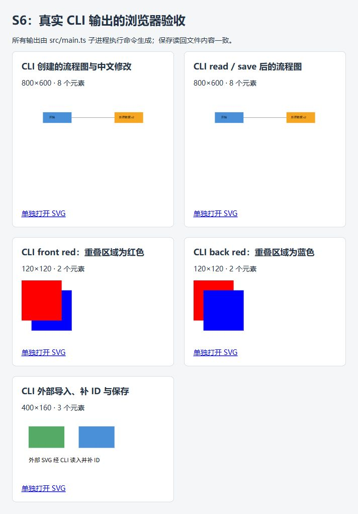

# S8：最终文档、验收与发布准备

## 状态与范围

2026-10-31（Asia/Shanghai）在 `8eff0ff7674dfec46087419c9939367d36bb3d38` 上完成本轮最终验收。S1—S7 的代码已在远程 `main`，本轮补齐最终文档、可复现会话和可随仓库交付的浏览器证据，不修改生产代码或扩大功能范围。

**当前状态：验收与文档已完成；本轮文件纳入本地提交，`final` 标签尚未创建，远程发布尚未执行。** 2026-10-31 按用户要求统一提交当前文档、示例与验收证据；生产代码和测试沿用已提交的 `8eff0ff`。本次提交范围不包括打标签或推送。

## 对照实验要求

| 要求与来源 | 核验结果 | 可复核证据 |
|---|---|---|
| 原文 §1.1：分阶段 Git 历史 | 通过；S1—S7 共 11 笔提交覆盖脚手架、领域、历史、层级、IO、CLI 和综合测试，本轮追加 S8 文档与验收提交 | 下方提交表及 `git log --reverse --oneline` |
| 原文 §1.1：最终版本 `final` 标签及远程代码 | 待最终发布确认 | 发布前远程 main 为 `8eff0ff`，远程不存在 `final` |
| 原文 §1.2：架构、设计模式、依赖方向与变化点 | 通过 | [主报告](./README.md) 的架构方案、PlantUML 和变化点表 |
| 原文 §1.2：过程记录、一致性自查、质量保证 | 通过 | [主报告](./README.md) 与 S1—S8 独立记录 |
| 原文 §2—§5：六类图形、19 条命令、错误与历史 | 通过本阶段验收用例；插件 box 不适用 | [S7 矩阵](./S7.md)、[验收规格](./acceptance-spec.md) |
| 原文 §6、§6.1：典型会话和流程图 | 通过真实 REPL 子进程；最终构建产物另做回放 | `cli-repl.test.ts`、[最终会话](./examples/final-session.txt) |
| SVG 保存读回及浏览器预览 | 五组样例加载与显示通过；保存读回的 DOM 一致 | [截图](./assets/s8-browser.jpg)、[浏览器记录](./assets/s8-browser.json) |

截止日期未在当前实验文本中给出，本记录只保存实际验收和发布时间，不推断是否符合课程提交截止时间。

## 文档与实际代码一致性

生产源码共 57 个 TypeScript 文件：domain 15、commands 19、application 9（含 ports）、infrastructure 6、cli 7，加装配入口 main.ts。架构检查没有发现违规依赖；每个具体类与文件同名。开发目录 scripts 共 6 个文件，包含预览服务和架构检查；不属于生产领域模型。

| 抽查调用路径 | 实际实现与约束 |
|---|---|
| `main → DocumentSession / SvgCli / NodeFileSystem / SvgReader / SvgWriter` | main 是装配入口，注入端口实现；REPL 本身位于 main.ts |
| `CommandRegistry → CommandExecutor → Command → Document / Shape` | 编辑成功后才入栈；失败保留历史；查询与文档操作分开 |
| `Shape.move/scale → prepareMove/prepareScale` | 整个子树先校验后提交，保持溢出失败原子性 |
| `Shape / Document → toNonNegativeNumber` | 尺寸、半径、描边宽度禁止负值；负坐标和零值合法 |
| `SvgReader → ShapeFactory → Document` | 完整解析成功后才替换当前文档；不泄漏部分导入结果 |
| `SvgWriter → Shape 公共属性/子列表` | 保留绘制顺序和文本 CR，不新增按叶子类型分派 |
| `ShapePresenter → ShapeVisitor` | 展示通过多态实现，领域层不依赖 CLI |

S8 修正了旧文档把 REPL 归入 cli 目录的描述，补充 scripts、doc/assets 和 doc/examples 的用途；将三个指向个人电脑绝对路径的 Markdown 链接改为仓库相对链接。原始实验文档保留不变，S1—S7 的历史测试数字保留原时间语境。

## 实际验证

本机环境：Windows、Node.js v22.16.0、npm 10.9.2；`npm ls --depth=0` 与锁定依赖一致。本轮使用已安装依赖，没有声称在另一台机器或新安装环境下验证。

| 检查 | 结果 |
|---|---|
| `node node_modules/vitest/vitest.mjs run --reporter=default --reporter=json --outputFile=tmp/s8-tests.json` | 19 个测试文件、531 个测试全部通过；2026-10-31 01:28:12 开始，约 5.89 秒 |
| `npm run typecheck` | 通过，覆盖 src/tests/scripts |
| `npm run build` | 通过，产物位于 dist |
| `npm run lint` | 通过；57 个生产源文件、0 项架构违规 |
| `git diff 5bec976..8eff0ff --check` | 通过；复核 S7 及非负值修复的提交差异 |
| 构建产物 `node dist/main.js` 回放最终会话 | 通过；正常 EOF、两条预期错误、8 个元素和几何值均匹配，结果保存在 `assets/s8-cli-result.json` |
| Markdown 本地文件链接 | 15 份 Markdown、89 个本地文件链接，无缺失目标或个人电脑绝对路径链接 |
| `git diff --check` 和工作区范围 | 通过；本轮仅修改文档和证据，src/tests/scripts 及依赖文件无变更 |

测试结果支持当前 Phase 1 CLI 的功能验收，不是行/分支覆盖率或缺陷为零的证明。

## 浏览器核验与证据

复用 S6CliPreviewServer，在独立的 `tmp/s8-cli-preview` 生成当前源码的真实 CLI 输出，通过仅监听 `127.0.0.1:8768` 的固定路由服务提供五组样例。

- flowchart 与 roundtrip 均为 800×600、8 个元素；浏览器中的节点顺序、父级、属性和中文内容完全一致，生成文件的 SHA-256 也相同。
- front / back 均为 120×120；截图目视核对重叠区域分别为红色和蓝色。本轮没有执行像素采样，不沿用 S6 的像素误差数值。
- imported 为 400×160；补 ID 后的外部图形和中文正常显示。
- 五张图片均完成加载，naturalWidth/naturalHeight 与预期一致。截图及 DOM 核验记录已经纳入 doc/assets，可在其他电脑查看。



## 可复现操作

首次取得仓库后，使用锁文件安装依赖，再执行项目检查：

```text
npm ci
npm test
npm run typecheck
npm run lint
npm run build
node dist/main.js
```

也可在项目根目录用 PowerShell 回放最终会话：

```powershell
New-Item -ItemType Directory -Force tmp | Out-Null
Get-Content -Encoding utf8 doc/examples/final-session.txt | node dist/main.js
```

预期只有两条错误：负 width 被拒绝；成功保存后 undo 因历史边界被拒绝。输出文件 `tmp/final-flowchart.svg` 为 800×600、8 个元素；process 的位置为 `(520,200)`，宽高保持 `160×60`，对应文字位于 `(545,235)`。本次实际生成的参考文件保存为 [final-flowchart.svg](./examples/final-flowchart.svg)。这些几何变化遵循原文，移动 node2 不会自动移动独立连线。

浏览器复现使用 `npm run preview:s6`，打开其打印的本机地址。该命令只生成与服务样例，浏览器检查仍须单独执行。

## 提交历史与最终发布

| 提交 | 阶段内容 |
|---|---|
| `e0cd527`、`3fc1f39`、`844a1a1` | 项目、TypeScript/Vitest 和 REPL 脚手架 |
| `598e8b3`、`7065b43` | 图形领域模型、工厂和步骤文档 |
| `e104df6` | 编辑命令和撤销重做 |
| `80b5101`、`9be3f33` | 层级、绘制顺序、原子性和结构保护 |
| `0888fd2` | SVG IO 和文档操作 |
| `5bec976` | 完整 CLI |
| `8eff0ff` | S7 测试、重构、文本保真和非负值约束 |
| 本文件所在的 S8 本地提交 | S8 最终报告、验收证据、可复现示例与文档整理 |

远程为 `https://github.com/Forst25571765/Lab1-SVG.git`。本轮验收基线为 `8eff0ff`；验收时已只读确认远程 main 与该基线一致，本地及远程不存在 `final`。本轮仅追加本地提交，纳入文档、示例和精简证据；node_modules、dist 和 tmp 继续忽略。

最终发布时，在最终验收提交创建附注标签 `final`，再将 main 与该标签一并推送。不得覆盖已有的远程提交或同名标签。完成后核对 `HEAD == origin/main == final^{}`，并用 `git ls-remote` 确认远程 main 与 final 解引用后的提交一致、工作区干净。上述发布操作未包含在本次本地提交中。

## 已知范围与保留风险

- 当前保证单进程、顺序 CLI 会话；绕过命令执行器直接修改 Document 后，再撤销旧的多步层级命令，仍有一致性风险。本轮按此前范围不修复该 API 旁路问题，不将其描述为已解决。
- 文件适配器有真实文件测试，但并非对每一次底层 open/write/rename/cleanup 都注入故障；未覆盖断电、磁盘故障和并发写入等系统场景。
- 未加入随机长序列/性质测试、行分支覆盖率统计、CI 和大规模深层树压力测试；已有确定性回归与实际进程测试提供本阶段证据。
- 外部 SVG 仅支持已声明的子集；transform、CSS/style、其他图形、插件 box 和异步文件接口不属于本阶段。

以上边界与最终发布状态均显式保留，避免把本阶段课程验收等同于通用 SVG 编辑器或生产级并发编辑系统。
